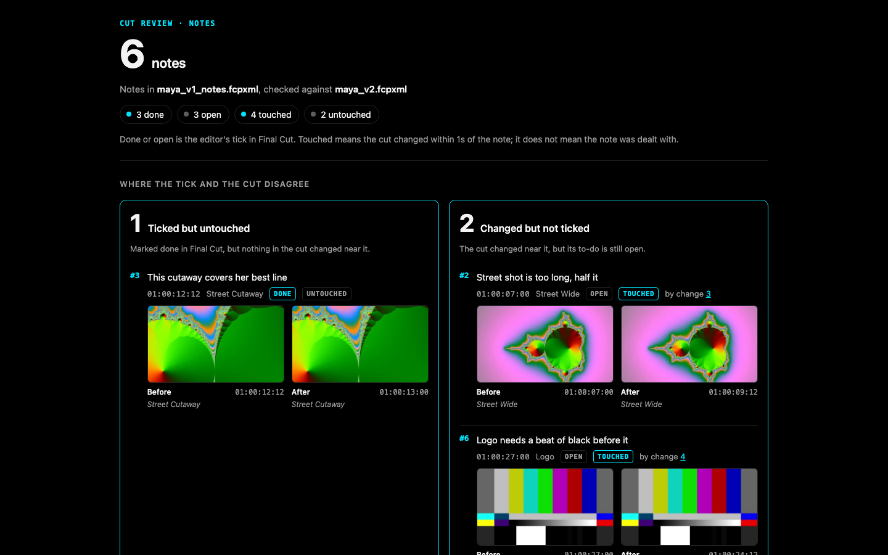

# Cut Review: Frame.io comments and client notes as Final Cut Pro to-do markers

**Cut Review is a free, open source command line tool and MCP server for Final Cut Pro.** It writes client notes and Frame.io comment exports into your project's FCPXML as to-do markers on the clips they are about. After the recut it compares two FCPXML exports and shows, on one page, what changed and which notes the recut touched, whether you or an AI agent made the edit.

[](https://pypi.org/project/cutreview/)
[](https://pypi.org/project/cutreview/)
[](https://github.com/DareDev256/cutreview/blob/main/LICENSE)

[](https://daredev256.github.io/cutreview/)

*The status page from the demo round, on synthesized test media. Website: [daredev256.github.io/cutreview](https://daredev256.github.io/cutreview/)*

## What this is not

- **Not a review platform.** There is no server, no account and no upload. Every page is one HTML file on your disk with nothing to load.
- **It says "touched", never "addressed".** Touched means the cut changed near a note. Whether the change is what the reviewer asked for is your call, and the page never claims otherwise.
- **No AI in the notes path.** Notes are read by rules you can read in [`src/cutreview/notes.py`](https://github.com/DareDev256/cutreview/blob/main/src/cutreview/notes.py). A note with no timecode is listed as not placed; it is never given a time. A line that cannot be read is listed with the reason; it is never dropped.
- **Not an editor.** It writes markers and nothing else. It never changes a clip, and it never opens or drives Final Cut.

## Quick start (60 seconds)

You need [uv](https://docs.astral.sh/uv/) (`brew install uv`), Python 3.10 or newer, and an XML export of your project from Final Cut Pro (**File > Export XML**).

1. Write your notes, one per line, timecode first, in `notes.txt`:
   ```
   00:00:05:00 Too long on B, cut it down
   00:00:13:00 Drone could breathe, slow it down
   ```
2. Put them on the cut as to-do markers:
   ```
   uvx cutreview notes cut.fcpxmld notes.txt
   ```
   This writes `cut_notes.fcpxmld` and prints where each note landed. In Final Cut, **File > Import > XML** and open the Timeline Index (Shift-Command-2) to see the to-dos.
3. Recut. Tick each to-do you dealt with. **File > Export XML** again, say as `cut_v2.fcpxmld`.
4. See which notes the recut touched, and what changed:
   ```
   uvx cutreview status cut_notes.fcpxmld cut_v2.fcpxmld -o status.html
   uvx cutreview diff cut_notes.fcpxmld cut_v2.fcpxmld -o review.html
   ```

`ffmpeg` on the path adds before and after frames (optional). Final Cut Pro on the same Mac lets every write be checked against Apple's own FCPXML DTD (optional; without it the check says it did not run).

## What it does

```
notes.txt ──► cutreview notes ──► cut_notes.fcpxml  (to-do markers on the clips)
                                       │
                         you, or an agent, recut it in Final Cut
                                       │
              cut_notes.fcpxml + next export ──► cutreview status ──► status.html
```

1. **`cutreview notes`** writes each note as a Final Cut to-do marker (`completed="0"`) on the clip whose picture shows at that time, in that clip's own source time, so the marker travels with the clip through the recut. The full note goes in the marker's note field.
2. You recut. Tick a to-do in Final Cut when you have dealt with it. Export XML.
3. **`cutreview status`** reads the next export. Each note is **done or open** (your tick, which Final Cut writes into the XML) and **touched or untouched** (did the cut change within a second of it). The page leads with the two places those disagree: *ticked but untouched*, and *changed but not ticked*. A note whose clip is gone reads "removed with its clip".

Two more commands work on any two exports, notes or not:

- **`cutreview diff old.fcpxml new.fcpxml -o review.html`**: the change page. Every clip added, removed, trimmed, moved, retimed or adjusted, and every transition added or removed, with a strip of the timeline and before and after frames when the media is on this machine. A clip that only slid because something before it got shorter is counted and not listed.
- **`cutreview blame old.fcpxml new.fcpxml`**: the same page, with each change attributed to the [fcp-mcp-server](https://github.com/DareDev256/fcp-mcp-server) tool call that made it, read from that server's write journal. A change the journal does not explain reads "not in the journal".

Screens from the demo round (synthesized media): [change page](https://raw.githubusercontent.com/DareDev256/cutreview/v0.1.0/docs/screenshots/2026-11-12_review-1440-dark.png), [status page](https://raw.githubusercontent.com/DareDev256/cutreview/v0.1.0/docs/screenshots/2026-11-12_status-1440-dark.png), [status page on a phone](https://raw.githubusercontent.com/DareDev256/cutreview/v0.1.0/docs/screenshots/2026-11-12_status-390-dark.png), [blame page on a phone](https://raw.githubusercontent.com/DareDev256/cutreview/v0.1.0/docs/screenshots/2026-11-12_blame-390-dark.png), [light mode](https://raw.githubusercontent.com/DareDev256/cutreview/v0.1.0/docs/screenshots/2026-11-12_review-1440-light.png).

## FAQ

### How do I get Frame.io comments into Final Cut Pro?

Export the comments from Frame.io as a CSV (in Frame.io V4: the three-dot menu in the Comments tab), then run `uvx cutreview notes cut.fcpxmld comments.csv` and import the result with **File > Import > XML**. Cut Review finds a Frame.io export by its `Commenter` and `Comment` columns, writes each comment as a to-do marker on the clip under it, folds replies into the comment they answer, flags drawn-on comments, and writes comments already marked complete as completed markers.

### Does it work with Frame.io V4?

Frame.io documents V4's comment export as CSV or plain text but publishes no column list. Cut Review reads the columns by name, never by position, and has been tested on a file rebuilt from the published V3-era names, not yet on a real V4 export. If your export does not read, [open an issue](https://github.com/DareDev256/cutreview/issues) with its header row.

### How do I import a CSV of notes as Final Cut Pro markers?

Any CSV with a header row works: Cut Review finds the time column by name (`timecode`, `time`, `tc`, `in`, `start`...) and the note column likewise (`note`, `comment`, `text`, `feedback`...), with an author column if there is one. `uvx cutreview notes cut.fcpxmld notes.csv` writes them as to-do markers. A row with no time is listed as not placed, never guessed.

### How do I compare two FCPXML files and see what changed between two Final Cut exports?

`uvx cutreview diff cut_v1.fcpxmld cut_v2.fcpxmld -o review.html` writes one HTML page listing every clip added, removed, trimmed, moved, retimed or adjusted, and every transition change, with a timeline strip and before and after frames. Clips are matched by source material, not by name, so a ripple, a head trim or a cut built on connected clips reads correctly.

### How do I check what an AI agent changed in my edit?

Run `cutreview diff` on the export before and after the agent worked. If the agent edited through [fcp-mcp-server](https://github.com/DareDev256/fcp-mcp-server), `uvx cutreview blame before.fcpxml after.fcpxml` names the tool call behind each change from that server's write journal, and marks anything done by hand as "not in the journal". If your notes were on the cut, `cutreview status` shows which of them the agent's changes touched.

### How do I track which client notes the recut dealt with?

Put the notes on the cut as to-do markers with `cutreview notes`, tick them in Final Cut as you work, then run `cutreview status` on the next export. Each note comes back done or open (your tick) and touched or untouched (whether the cut changed within a second of it), and the page starts with the notes where those two disagree.

### Is Cut Review a Frame.io alternative?

No. It does not host video or collect comments from clients. It works on the notes you already get, from Frame.io, email, texts or a call, and on Final Cut's own XML exports.

### Is there an MCP server for Final Cut Pro?

Yes: [fcp-mcp-server](https://github.com/DareDev256/fcp-mcp-server) lets Claude and other MCP clients read and edit Final Cut Pro timelines through FCPXML. Cut Review is the review step beside it, as one MCP tool, `review`, with the actions `diff`, `blame`, `notes` and `status` (see [As an MCP tool](#as-an-mcp-tool)).

## How it compares

| | Cut Review | Change List X | Marker Toolbox | Frame.io V4 |
|---|---|---|---|---|
| What it is | Free, open source command line tool and MCP server (MIT) | Mac app, US$199.99 | Final Cut workflow extension, US$19.99 | Hosted review platform, free and paid plans |
| Notes into Final Cut as markers | Yes: plain text, any CSV, Frame.io comment CSV, as to-do markers on the clip | No | Yes: Frame.io FIOJSON (including the V4 beta), Vimeo, Wipster, Dropbox Replay, Premiere CSV, Timecode+, email text; resolved comments arrive completed | Comment export as CSV or text; its V3 "Import Comments into FCP" article now redirects to the help center home |
| Compares two versions of the cut | Any two FCPXML exports, every lane, matched by source material | Primary storylines of two projects, as a PDF or TSV change list with pull and discard lists | No | Plays two uploaded versions side by side or overlaid: the pictures, not the timeline's clips |
| Which notes the recut touched | Yes: done or open, against touched or untouched | No | No | No |
| Which agent tool call made each change | Yes, from fcp-mcp-server's journal | No | No | No |

Read from each product's own page on 2026-11-12: [Change List X](https://apps.apple.com/us/app/change-list-x/id694746044), [Marker Toolbox](https://markertoolbox.fcp.cafe/), [Frame.io comment export](https://help.frame.io/en/articles/9105309-comment-printing-and-comment-exporting), [Frame.io Comparison Viewer](https://help.frame.io/en/articles/9952618-comparison-viewer). Prices are the US Mac App Store's.

Use Change List X when you need a conform change list for sound or VFX, in feet and frames, with pull and discard lists. Use Marker Toolbox when your notes come from Vimeo, Wipster, Dropbox Replay or Frame.io's FIOJSON download, or when you want drawn annotations brought across. Cut Review is for the step after the notes are on the cut: knowing which ones the recut actually changed.

## The notes door

```
$ cutreview notes music-video.fcpxml music-video.notes.txt
6 notes written as to-do markers into music-video_notes.fcpxml
Times counted from the sequence's start timecode.
  #1   00:00:00:12  on SHOT A 1: Open on something brighter, this feels flat
  #2   00:00:05:00  on SHOT B 1: Too long on B, cut it down
  #3   00:00:02:12  on OVERLAY 1: Overlay 1 is too busy, lose it
  #4   00:00:10:12  on OVERLAY 3: Overlay 3 distracts from the lyric
  #5   00:00:13:00  on DRONE 1: Drone could breathe, slow it down
  #6   00:00:30:00  on TRACK (audio only under it): Hold on the performance here
2 not placed (listed, never guessed):
  music-video.notes.txt line 8: no timecode: Overall the colour is great, no notes on the grade
  music-video.notes.txt line 11: after the end of the cut: Fade out sooner
2 unreadable (listed, never dropped):
  music-video.notes.txt line 9: '00:01:75:00' has minutes or seconds past 59: 00:01:75:00 Check the lyric sync
  music-video.notes.txt line 10: a timecode with no note after it: 00:00:13:00
Checked: Valid against FCPXML 1.13 DTD (FCPXMLv1_13.dtd); 6 markers read back on their clips, each within one frame.
Ledger: music-video_notes.fcpxml.cutreview.json
```

Three formats are read:

- **Plain text**, one note per line, timecode first: `00:01:23:12 note`, `1:23 note`, `[00:01:23:12] note`, a range `00:01:23:12 - 00:01:25:00 note`. An indented line continues the note above it.
- **CSV** with a header row. The time column is found by name (`timecode`, `time`, `tc`, `in`, `start`...), the note column likewise (`note`, `comment`, `text`, `feedback`...), and an author column if there is one. A time may be a timecode or plain seconds.
- **Frame.io's comment CSV export**, found by its `Commenter` and `Comment` columns. Columns are matched by name, so added or reordered columns still read. Replies are folded into the comment they answer, drawn-on comments are flagged, and comments already marked complete are written as completed markers. `--source-tc` uses the Timecode Source columns. Frame.io publishes no column list for V4; see [DECISIONS.md](https://github.com/DareDev256/cutreview/blob/main/DECISIONS.md) for where the names come from.

Timecodes count from the sequence's start timecode, as Final Cut shows them. If the sequence starts at zero, the cut is under an hour, and every note reads past 01:00:00:00, cutreview reads the file as a review copy with an hour start and says so. `--start-tc` sets it by hand.

Two checks run on every write, and either one failing leaves no file behind: `xmllint` against Apple's own FCPXML DTD from the installed Final Cut Pro, and a read-back through fcp-mcp-server's parser that must find each marker on its clip within one frame. Files are written as FCPXML 1.13 (a 1.14 input stays 1.14).

## The change door

`cutreview diff` compares material, not clip names. Each clip is a range of a source file; two cuts are compared source by source:

| Reads as | When |
|---|---|
| removed / added | a clip's material is wholly gone, or wholly new |
| trimmed | some of a clip's material left or entered at its start, its end or its middle |
| moved | material now plays out of order on the primary storyline, or a connected clip moved off its anchor or to another lane |
| retimed | the clip's speed changed |
| adjusted | an `adjust-*` or `filter-*` setting changed, or the clip was disabled |
| transition | a transition was added, removed or changed length |

Clips that only slid with a ripple are counted, not listed. Frames on the page are source frames: effects, titles and grades are not drawn.

`cutreview blame` reads fcp-mcp-server's journal from `FCP_MCP_JOURNAL`, the project folder (or its `journal/` or `.fcp-mcp/journal/`), or `~/.fcp-mcp/journal/`, and walks it hash by hash from the old file. Each change goes to the last journaled write that changed that material. Work done after the last journaled write reads "not in the journal (by hand in Final Cut, or a tool with no journal)". If a file between two writes is gone, those writes are named together.

## As an MCP tool

```
uvx cutreview mcp
```

One tool, `review`, over stdio, with four actions: `diff`, `blame`, `notes`, `status`. Every file it writes stays inside the folder of the cut it was given.

Claude Code:

```
claude mcp add cutreview -- uvx cutreview mcp
```

Claude Desktop and other clients that take a JSON config:

```json
{
  "mcpServers": {
    "cutreview": { "command": "uvx", "args": ["cutreview", "mcp"] }
  }
}
```

Its name in the official MCP registry is `io.github.DareDev256/cutreview`. It pairs with [fcp-mcp-server](https://github.com/DareDev256/fcp-mcp-server), which does the editing.

## Work on it

```
git clone https://github.com/DareDev256/cutreview && cd cutreview
uv venv && uv pip install -e ".[dev]"
.venv/bin/python -m pytest
```

## What "touched" means, exactly

A note is touched when a change lies within one second (`--reach`) of the note's frames on the earlier cut, or of its marker on the later cut. A change on an audio lane touches only notes that sit on audio, so moving the music bed does not touch a note about the picture. A clip that only slid with a ripple is not a change and touches nothing. That is all. A trim beside a note touches it whether or not it is the trim the reviewer wanted.

## Limits in v0.1

- Final Cut only. Resolve and Premiere projects wait for v0.2.
- One round trip into Final Cut 12.4 is written up in [`docs/final-cut-proof.md`](https://github.com/DareDev256/cutreview/blob/main/docs/final-cut-proof.md) and not yet run.
- No voice notes, no notes without timecodes placed, no undo of a single change.
- A speed ramp is read as one average speed.
- Clips inside compound clips are not looked into.

## Credits

Built on [fcp-mcp-server](https://github.com/DareDev256/fcp-mcp-server) (MIT), which supplies the FCPXML parser, the writer's element walker, the write journal and the DTD check. The fixtures `fixtures/music-video.fcpxml` and `fixtures/sample.fcpxml` come from its examples; its license is in [`fixtures/LICENSE-fcp-mcp-server`](https://github.com/DareDev256/cutreview/blob/main/fixtures/LICENSE-fcp-mcp-server).

## License

MIT. Copyright (c) 2026 James Olusoga (DareDev256), [jamesdare.com](https://jamesdare.com).

<!-- mcp-name: io.github.DareDev256/cutreview -->
