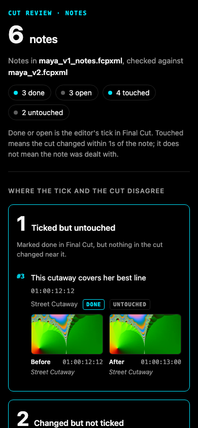

# Cut Review

Final Cut review notes in as to-do markers. Two exports of the cut in, one page out: what changed, and which notes it touched.

## What this is not

- **Not a review platform.** There is no server, no account and no upload. Every page is one HTML file on your disk with nothing to load.
- **It says "touched", never "addressed".** Touched means the cut changed near a note. Whether the change is what the reviewer asked for is your call, and the page never claims otherwise.
- **No AI in the notes path.** Notes are read by rules you can read in `src/cutreview/notes.py`. A note with no timecode is listed as not placed; it is never given a time. A line that cannot be read is listed with the reason; it is never dropped.
- **Not an editor.** It writes markers and nothing else. It never changes a clip, and it never opens or drives Final Cut.

## What it does

```
notes.txt ──► cutreview notes ──► cut_notes.fcpxml  (to-do markers on the clips)
                                       │
                         you, or an agent, recut it in Final Cut
                                       │
              cut_notes.fcpxml + next export ──► cutreview status ──► status.html
```

1. **`cutreview notes`** writes each note as a Final Cut to-do marker (`completed="0"`) on the clip whose picture shows at that time, in that clip's own source time, so the marker travels with the clip through the recut. The full note goes in the marker's note field.
2. You recut. Tick a to-do in Final Cut when you have dealt with it. Export XML.
3. **`cutreview status`** reads the next export. Each note is **done or open** (your tick, which Final Cut writes into the XML) and **touched or untouched** (did the cut change within a second of it). The page leads with the two places those disagree: *ticked but untouched*, and *changed but not ticked*. A note whose clip is gone reads "removed with its clip".

Two more commands work on any two exports, notes or not:

- **`cutreview diff old.fcpxml new.fcpxml -o review.html`**: the change page. Every clip added, removed, trimmed, moved, retimed or adjusted, and every transition added or removed, with a strip of the timeline and before and after frames when the media is on this machine. A clip that only slid because something before it got shorter is counted and not listed.
- **`cutreview blame old.fcpxml new.fcpxml`**: the same page, with each change attributed to the [fcp-mcp-server](https://github.com/DareDev256/fcpxml-mcp-server) tool call that made it, read from that server's write journal. A change the journal does not explain reads "not in the journal".



Screens from the demo round (synthesized media): [change page](docs/screenshots/2026-11-12_review-1440-dark.png), [status page](docs/screenshots/2026-11-12_status-1440-dark.png), [blame page on a phone](docs/screenshots/2026-11-12_blame-390-dark.png), [light mode](docs/screenshots/2026-11-12_review-1440-light.png).

## Install

Python 3.10 or newer, macOS or Linux. `ffmpeg` on the path for frames (optional). Final Cut Pro on the same Mac for the DTD check (optional; without it the check says it did not run).

In a clone of this repo:

```
uvx --from . cutreview --help
```

or, to work on it:

```
uv venv && uv pip install -e ".[dev]"
.venv/bin/cutreview --help
.venv/bin/python -m pytest
```

## The notes door

```
$ cutreview notes music-video.fcpxml music-video.notes.txt
6 notes written as to-do markers into music-video_notes.fcpxml
Times counted from the sequence's start timecode.
  #1   00:00:00:12  on SHOT A 1: Open on something brighter, this feels flat
  #2   00:00:05:00  on SHOT B 1: Too long on B, cut it down
  #3   00:00:02:12  on OVERLAY 1: Overlay 1 is too busy, lose it
  #4   00:00:10:12  on OVERLAY 3: Overlay 3 distracts from the lyric
  #5   00:00:13:00  on DRONE 1: Drone could breathe, slow it down
  #6   00:00:30:00  on TRACK (audio only under it): Hold on the performance here
2 not placed (listed, never guessed):
  music-video.notes.txt line 8: no timecode: Overall the colour is great, no notes on the grade
  music-video.notes.txt line 11: after the end of the cut: Fade out sooner
2 unreadable (listed, never dropped):
  music-video.notes.txt line 9: '00:01:75:00' has minutes or seconds past 59: 00:01:75:00 Check the lyric sync
  music-video.notes.txt line 10: a timecode with no note after it: 00:00:13:00
Checked: Valid against FCPXML 1.13 DTD (FCPXMLv1_13.dtd); 6 markers read back on their clips, each within one frame.
Ledger: music-video_notes.fcpxml.cutreview.json
```

Three formats are read:

- **Plain text**, one note per line, timecode first: `00:01:23:12 note`, `1:23 note`, `[00:01:23:12] note`, a range `00:01:23:12 - 00:01:25:00 note`. An indented line continues the note above it.
- **CSV** with a header row. The time column is found by name (`timecode`, `time`, `tc`, `in`, `start`...), the note column likewise (`note`, `comment`, `text`, `feedback`...), and an author column if there is one. A time may be a timecode or plain seconds.
- **Frame.io's comment CSV export**, found by its `Commenter` and `Comment` columns. Columns are matched by name, so added or reordered columns still read. Replies are folded into the comment they answer, drawn-on comments are flagged, and comments already marked complete are written as completed markers. `--source-tc` uses the Timecode Source columns. Frame.io publishes no column list for V4; see DECISIONS.md for where the names come from.

Timecodes count from the sequence's start timecode, as Final Cut shows them. If the sequence starts at zero, the cut is under an hour, and every note reads past 01:00:00:00, cutreview reads the file as a review copy with an hour start and says so. `--start-tc` sets it by hand.

Two checks run on every write, and either one failing leaves no file behind: `xmllint` against Apple's own FCPXML DTD from the installed Final Cut Pro, and a read-back through fcp-mcp-server's parser that must find each marker on its clip within one frame. Files are written as FCPXML 1.13 (a 1.14 input stays 1.14).

## The change door

`cutreview diff` compares material, not clip names. Each clip is a range of a source file; two cuts are compared source by source:

| Reads as | When |
|---|---|
| removed / added | a clip's material is wholly gone, or wholly new |
| trimmed | some of a clip's material left or entered at its start, its end or its middle |
| moved | material now plays out of order on the primary storyline, or a connected clip moved off its anchor or to another lane |
| retimed | the clip's speed changed |
| adjusted | an `adjust-*` or `filter-*` setting changed, or the clip was disabled |
| transition | a transition was added, removed or changed length |

Clips that only slid with a ripple are counted, not listed. Frames on the page are source frames: effects, titles and grades are not drawn.

`cutreview blame` reads fcp-mcp-server's journal from `FCP_MCP_JOURNAL`, the project folder (or its `journal/` or `.fcp-mcp/journal/`), or `~/.fcp-mcp/journal/`, and walks it hash by hash from the old file. Each change goes to the last journaled write that changed that material. Work done after the last journaled write reads "not in the journal (by hand in Final Cut, or a tool with no journal)". If a file between two writes is gone, those writes are named together.

## As an MCP tool

```
cutreview mcp
```

One tool, `review`, over stdio, with four actions: `diff`, `blame`, `notes`, `status`. Every file it writes stays inside the folder of the cut it was given. Claude Code:

```
claude mcp add cutreview -- uvx --from "$PWD" cutreview mcp
```

(run from the clone, so `$PWD` is the repo).

## What "touched" means, exactly

A note is touched when a change lies within one second (`--reach`) of the note's frames on the earlier cut, or of its marker on the later cut. A change on an audio lane touches only notes that sit on audio, so moving the music bed does not touch a note about the picture. A clip that only slid with a ripple is not a change and touches nothing. That is all. A trim beside a note touches it whether or not it is the trim the reviewer wanted.

## Limits in v0.1

- Final Cut only. Resolve and Premiere projects wait for v0.2.
- One round trip into Final Cut 12.4 is written up in `docs/final-cut-proof.md` and not yet run.
- No voice notes, no notes without timecodes placed, no undo of a single change.
- A speed ramp is read as one average speed.
- Clips inside compound clips are not looked into.

## Credits

Built on [fcp-mcp-server](https://github.com/DareDev256/fcpxml-mcp-server) (MIT), which supplies the FCPXML parser, the writer's element walker, the write journal and the DTD check. The fixtures `fixtures/music-video.fcpxml` and `fixtures/sample.fcpxml` come from its examples; its license is in `fixtures/LICENSE-fcp-mcp-server`.

## License

MIT. Copyright (c) 2026 James Olusoga (DareDev256).
